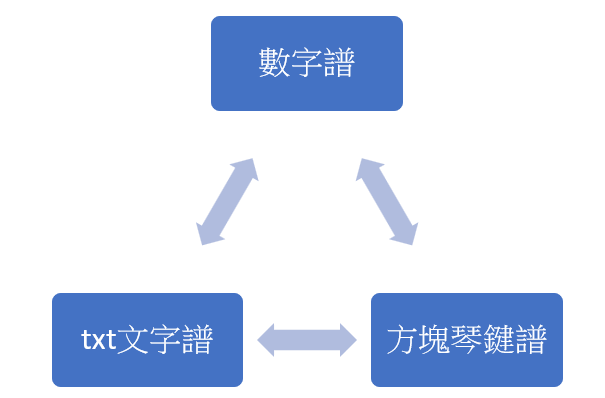
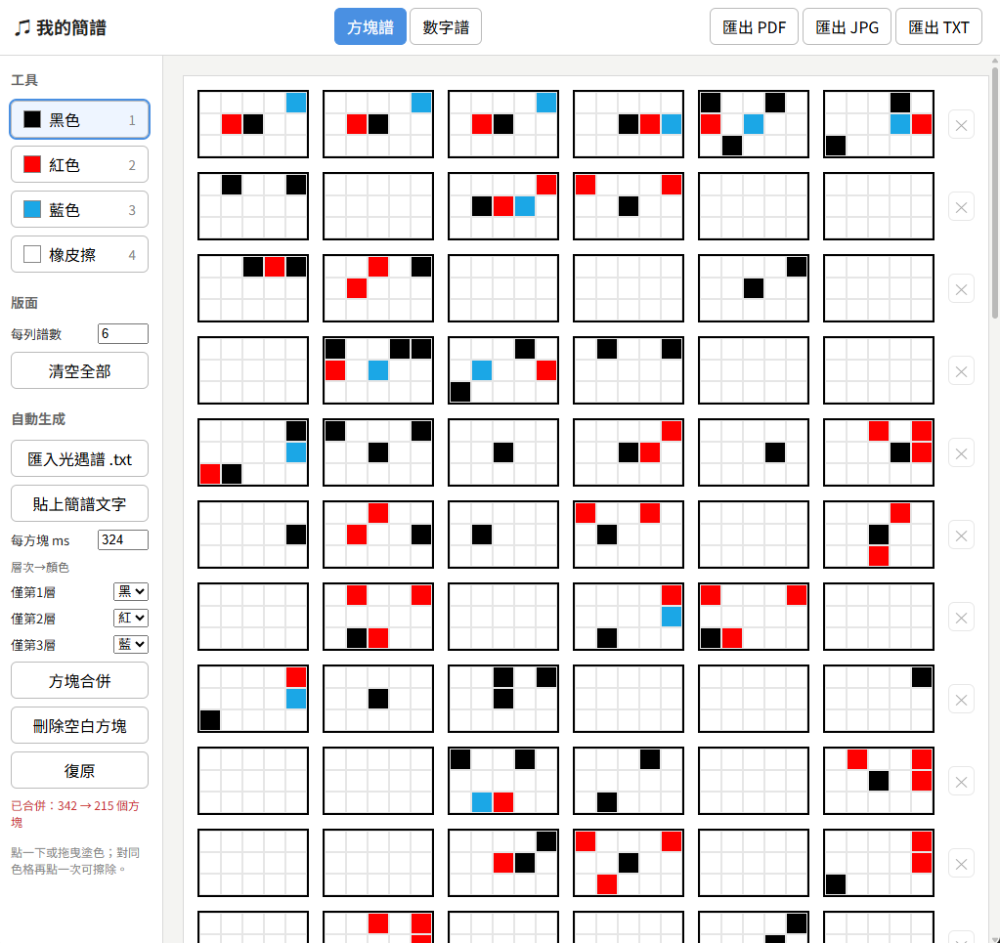
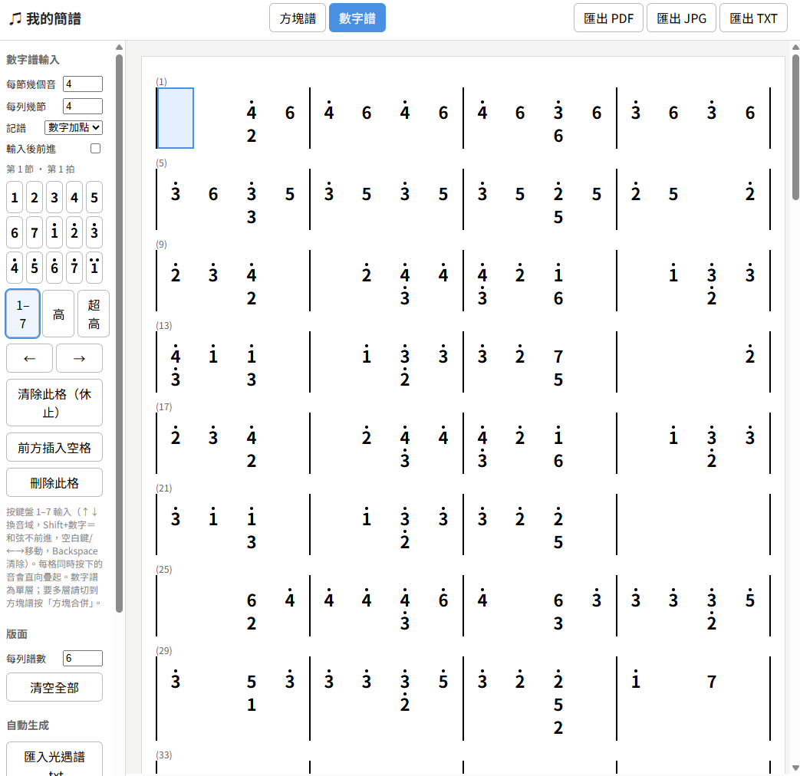
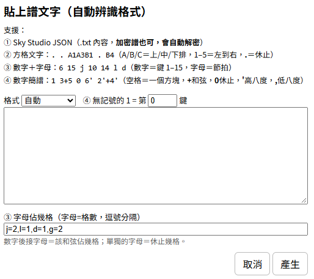

[繁體中文](README.md) ｜ **English** ｜ [Tiếng Việt](README.vi.md) ｜ [日本語](README.ja.md)

# ♫ My Block Score

An online tool that converts *Sky: Children of the Light* music sheets into block scores and numbered notation.

No installation needed — just open the page to edit, save, and export your scores.

🌐 The interface supports **繁體中文 / English / Tiếng Việt / 日本語**. Use the language menu at the top-left of the page to switch (your choice is remembered).



## Use it online

🌐 https://anna0212anna0212.github.io/sky/

## Screenshots




## Features

### Block score editor

- Each block is **5 × 3 = 15 keys**
- Supports:
  - Black (layer 1)
  - Red (layer 2)
  - Blue (layer 3)
- Click or drag to paint quickly
- Click a cell of the same color again to erase it
- Eraser tool included

### Shortcuts

| Key | Function |
|--------|--------|
| 1 | Black |
| 2 | Red |
| 3 | Blue |
| 4 or 0 | Eraser |

## Importing Sky scores

### Supported formats

- `.txt`
- `.json`

✅ Score files exported from **Sky Studio** are supported (encrypted scores work too and are decrypted automatically).

✅ Similar formats that also work:

```[{"time":0,"key":"1Key8"},{"time":260,"key":"1Key9"},{"time":520,"key":"1Key14"}]```

```A1A4B1 . . . . . . . . . . . . . B3 . . . . . . . . . . . A3B1B4 . . . . . . . . . . . . . . . A3A5B2B5```

```6 15 j 10 14 j 13 15 j 14 j 4 15 j 8 12 j 11 15 j 11 l d 8 l 10 l 6 15 j 10 14 j 13 15 j 14```

```[75,89,-22,98,43,90,126,-21,43,24,14,22,77,56,82,57,68,19,5,93,64,123,71,-31,100,48,137]```

| Format | How it is detected | Status |
|--------------------------|--------------------------------------------|-----------------|
| Sky Studio JSON | Starts with `[` or `{` and contains `songNotes` | Fully supported |
| Grid text | Almost every token is `.` or `A1`–`C5` | Supported |
| Numbers + letters | Anything else, e.g. `6 15 j 10` | Supported, but the beat timing is a guess |
| Plain number array | A JSON array made only of numbers | ⭐ Supported — latest update! |

### How it works

After importing, the tool automatically:

- Analyzes note timing
- Estimates the beat interval (ms)
- Converts it into a block score
- Builds multiple rows of the score

You can also adjust:

- Milliseconds per block
- The color mapping rules
- How the two layers are displayed

🌟 When using a Sky Studio score, note that key colors may not follow the beat order! They are assigned according to the imported file.

## Pasting score text (format auto-detected)



### Format rules

Supported:
① Sky Studio JSON (`.txt` contents; encrypted scores work too and are decrypted automatically)
② Grid text: `. . A1A3B1 . B4` (A/B/C = top/middle/bottom row, 1–5 = left to right, `.` = rest)
③ Numbers + letters: `6 15 j 10 14 l d` (number = key 1–15, letter = beat length)
④ Numbered notation: `1 3+5 0 6' 2'+4'` (space = one block, `+` chord, `0` rest, `'` octave up, `,` octave down)

- Separate blocks with spaces
- Use `+` for chords
- `0` is a rest
- `'` raises one octave
- `,` lowers one octave

Example:

```text
1 3+5 0 6' 2'+4'
```

(Tip: you can give a picture of a numbered score to an AI and ask it to turn it into this text format, then paste it in.)

## Merging blocks
⛔ (Switching to the number score cancels the merge — a merged score doesn't make much sense in numbered notation.)

Consecutive blocks are merged in time order, and note information is shown through the colors of different layers, making the score easier to read.

- Layer 1: black
- Layer 2: red
- Layer 3: blue
- 🌟 Blank blocks mean rests; they are not merged and keep their original position.
  To merge everything, first press "Remove blank blocks", then merge.
- "Remove blank blocks" is provided to tidy up the score as needed.
- After merging you can use "Undo" to restore the score as it was before.

If you merge an already-merged score again, the system treats the existing colors as black and recalculates the layers. If you don't want the existing layers to be split again, use Undo instead.

## Number score

A more intuitive way to enter notes with numbers, so you don't have to paint cells by hand.

### Entering notes

- Use keyboard keys `1`–`7` to enter notes.
- Click the number pad on the right to enter notes.
- Use `↑` / `↓` to switch octaves.
- Use `←` / `→` or the space bar to move the beat cursor.
- Hold `Shift` to enter a chord on the same beat.

### Notation and layout settings

Three notation styles are available:

- Numbers with dots
- High-pitch marks
- A–C with numbers

You can also customize the number of beats per measure and the number of measures per row to fit the song's rhythm and your layout needs.

## Update: score playback and preview

Play your score right after editing to check the melody, pitch, and rhythm, saving the time of repeatedly editing and testing inside the game.

**Playback settings**

- **▶ Play:** plays the current score so you can preview the melody and check the notes.
- **Pitch (1 =):** sets which pitch the number `1` corresponds to, so you can shift the range of the whole piece.
- **Key (C, etc.):** choose different keys, including sharps and flats, to adjust the pitch layout of the piece.
- **Instrument (Piano):** several instrument sounds to try.
- **Playback speed:** adjust the speed to check notes slowly, practice rhythm, or preview the full piece faster.
- **Layers in order:** choose whether to play the different note layers one after another, to listen to and check each layer separately.

**Please note**

This feature is mainly for previewing and assisting score writing. Because the browser-synthesized sounds differ from the real instrument sounds in *Sky: Children of the Light*, 🥲 playback may not fully reproduce the in-game sound. Please rely on the actual in-game performance.

# Contact me

If you run into any problems or have suggestions, feel free to contact me:

✉️ Email: yim20000101@gmail.com
