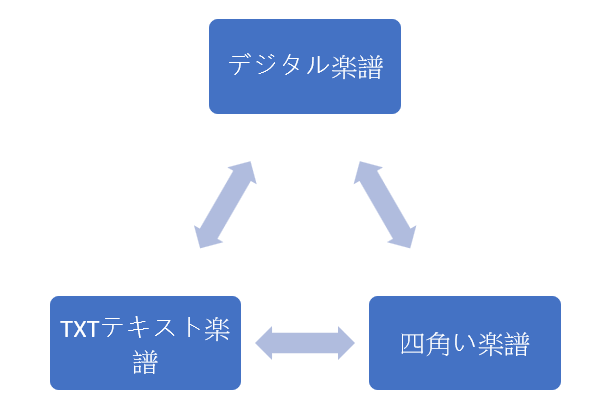
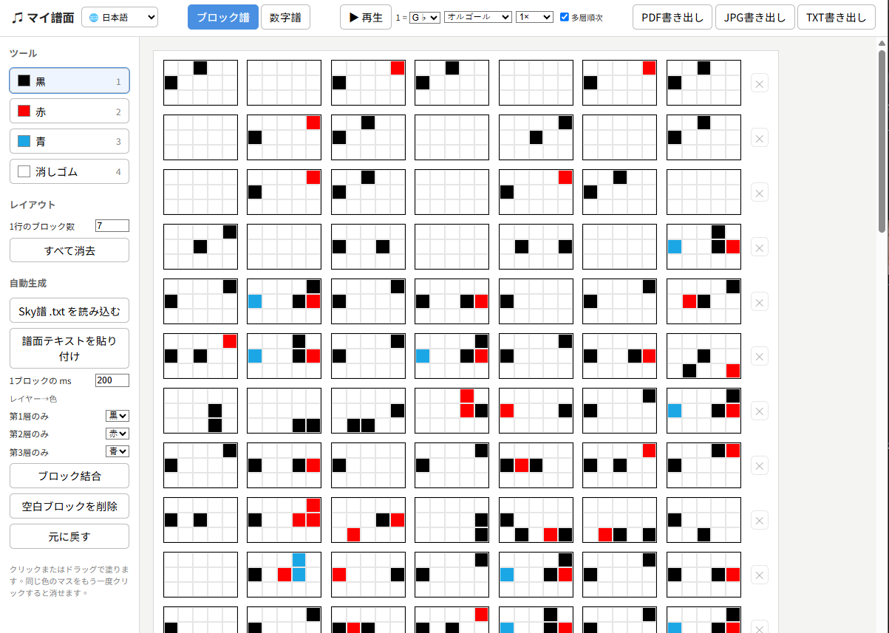
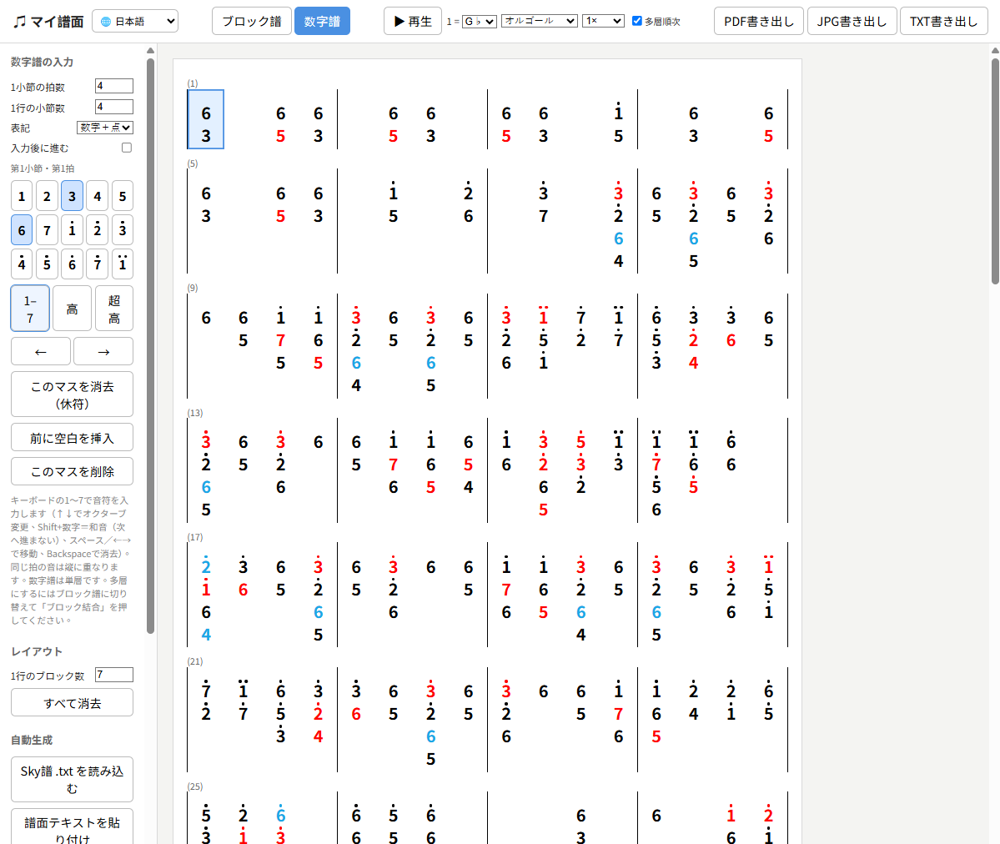
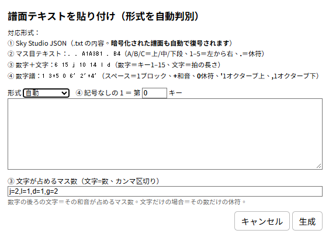

[繁體中文](README.md) ｜ [English](README.en.md) ｜ [Tiếng Việt](README.vi.md) ｜ **日本語**

# ♫ マイ・ブロック譜

『Sky 星を紡ぐ子どもたち』の楽譜を、ブロック譜や数字譜に変換するオンラインツールです。

ソフトのインストールは不要。ページを開くだけで、楽譜の編集・保存・書き出しができます。

🌐 画面は **繁體中文 / English / Tiếng Việt / 日本語** に対応しています。ページ左上の言語メニューで切り替えできます（選択は記憶されます）。



## オンラインで使う

🌐 https://anna0212anna0212.github.io/sky/

## 画面プレビュー




## 特長

### ブロック譜エディタ

- 1ブロックは **5 × 3 ＝ 15 キー**
- 対応する色：
  - 黒（第1層）
  - 赤（第2層）
  - 青（第3層）
- クリックまたはドラッグですばやく描画
- 同じ色のマスをもう一度クリックすると消去
- 消しゴムツール付き

### ショートカットキー

| キー | 機能 |
|--------|--------|
| 1 | 黒 |
| 2 | 赤 |
| 3 | 青 |
| 4 または 0 | 消しゴム |

## Sky 譜の読み込み

### 対応ファイル形式

- `.txt`
- `.json`

✅ **Sky Studio** から書き出した譜面ファイルに対応しています（暗号化された譜面も自動で復号されます）。

✅ 次のような似た形式も使えます：

```[{"time":0,"key":"1Key8"},{"time":260,"key":"1Key9"},{"time":520,"key":"1Key14"}]```

```A1A4B1 . . . . . . . . . . . . . B3 . . . . . . . . . . . A3B1B4 . . . . . . . . . . . . . . . A3A5B2B5```

```6 15 j 10 14 j 13 15 j 14 j 4 15 j 8 12 j 11 15 j 11 l d 8 l 10 l 6 15 j 10 14 j 13 15 j 14```

```[75,89,-22,98,43,90,126,-21,43,24,14,22,77,56,82,57,68,19,5,93,64,123,71,-31,100,48,137]```

| 形式 | 判別方法 | 状態 |
|--------------------------|--------------------------------------------|-----------------|
| Sky Studio JSON | `[` または `{` で始まり、`songNotes` を含む | 完全対応 |
| マス目テキスト | ほぼすべての語が `.` または `A1`〜`C5` | 対応 |
| 数字＋文字 | 上記以外。例：`6 15 j 10` | 対応（ただし拍の長さは推測） |
| 数字だけの配列 | すべて数字の JSON 配列 | ⭐ 対応（最新アップデート！） |

### 読み込み後の処理

読み込むと、自動的に次の処理を行います：

- 音符のタイミングを解析
- 拍の間隔（ms）を推定
- ブロック譜に変換
- 複数行の譜面を自動作成

次の項目は自分で調整することもできます：

- 1ブロックあたりのミリ秒数
- 色の対応ルール
- 2層の表示方法

🌟 Sky Studio の譜面を使う場合、キーの色は拍の順番どおりとは限りません！読み込んだファイルの内容に従って設定されます。

## 譜面テキストの貼り付け（形式を自動判別）



### 形式のルール

対応形式：
① Sky Studio JSON（`.txt` の内容。暗号化された譜面も自動で復号されます）
② マス目テキスト：`. . A1A3B1 . B4`（A/B/C＝上/中/下段、1–5＝左から右、`.`＝休符）
③ 数字＋文字：`6 15 j 10 14 l d`（数字＝キー1–15、文字＝拍の長さ）
④ 数字譜：`1 3+5 0 6' 2'+4'`（スペース＝1ブロック、`+` 和音、`0` 休符、`'` 1オクターブ上、`,` 1オクターブ下）

- ブロックはスペースで区切ります
- 和音は `+` を使います
- `0` は休符です
- `'` は1オクターブ上です
- `,` は1オクターブ下です

例：

```text
1 3+5 0 6' 2'+4'
```

（数字譜の画像を先に AI に渡して、この形式のテキストに変換してもらってから貼り付けることもできます。）

## ブロック結合
⛔ （数字譜に切り替えると結合は解除されます。数字譜で結合した譜面を見る人はあまりいないと思うので、少し不自然になります。）

連続するブロックを時間順に結合し、層ごとの色で音符の情報を表すことで、楽譜を読みやすくします。

- 第1層：黒
- 第2層：赤
- 第3層：青
- 🌟 空白ブロックは休符を表し、自動では結合されず、元の位置に残ります。
  すべてを結合したい場合は、先に「空白ブロックを削除」を押してから結合してください。
- 譜面を整理するための「空白ブロックを削除」機能があります。
- 結合後は「元に戻す」で結合前の譜面に戻せます。

すでに結合済みの譜面を再度結合すると、現在の色はすべて黒として扱われ、層が再計算されます。元の層を再び分割されたくない場合は、元に戻す機能を使ってください。

## 数字譜

数字を使って音符を入力できる、より直感的な入力方法です。1マスずつ塗る必要がありません。

### 音符の入力方法

- キーボードの `1`〜`7` で音符を入力します。
- 右側の数字キーパッドをクリックして入力できます。
- `↑`／`↓` でオクターブを切り替えます。
- `←`／`→` またはスペースキーで拍の位置を移動します。
- `Shift` を押しながら入力すると、同じ拍に和音を入力できます。

### 記譜とレイアウトの設定

3種類の表記方法から選べます：

- 数字＋点
- 高音記号
- A〜C＋数字

また、1小節の拍数や1行の小節数を自由に設定して、曲のリズムやレイアウトに合わせられます。

## アップデート：楽譜の再生と試聴

編集が終わったらそのまま再生して、メロディ・音の高さ・リズムを確認できます。ゲーム内で何度も試す手間を減らせます。

**再生設定**

- **▶ 再生：** 現在の楽譜を再生し、メロディや音符を確認できます。
- **音高（1 ＝）：** 数字 `1` に対応する音の高さを設定し、曲全体の音域を調整できます。
- **調（C など）：** シャープやフラットを含むさまざまな調を選び、曲の音高を調整できます。
- **音色（ピアノ）：** 複数の音色から選べます。
- **再生速度：** 速度を変えて、ゆっくり音符を確認したり、リズムを練習したり、全体を速く試聴したりできます。
- **多層順次再生：** 層ごとに順番に再生するかを選べ、各層を個別に聴いて確認できます。

**ご注意**

この機能は、楽譜の試聴と作成の補助が主な目的です。ブラウザで合成した音色は『Sky 星を紡ぐ子どもたち』のゲーム内の楽器の音色とは異なるため🥲、再生結果がゲーム内の音と完全には一致しない場合があります。実際のゲーム内の演奏を基準にしてください。

# お問い合わせ

このツールの使用中に問題が起きた場合や、ご提案がある場合は、お気軽にご連絡ください：

✉️ メール：yim20000101@gmail.com
