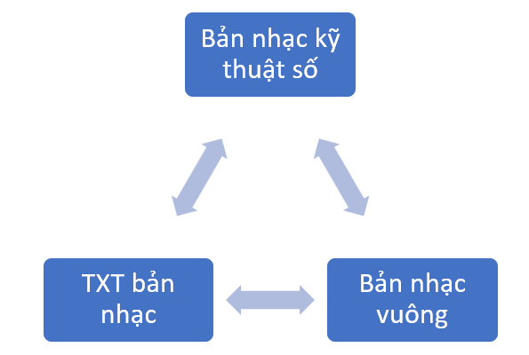
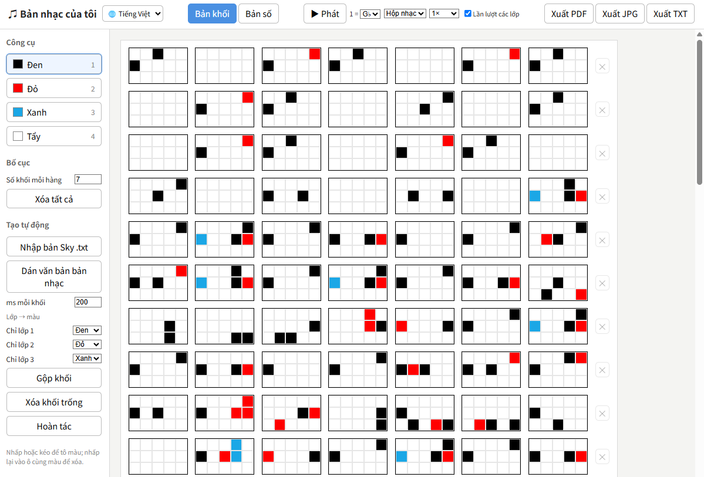
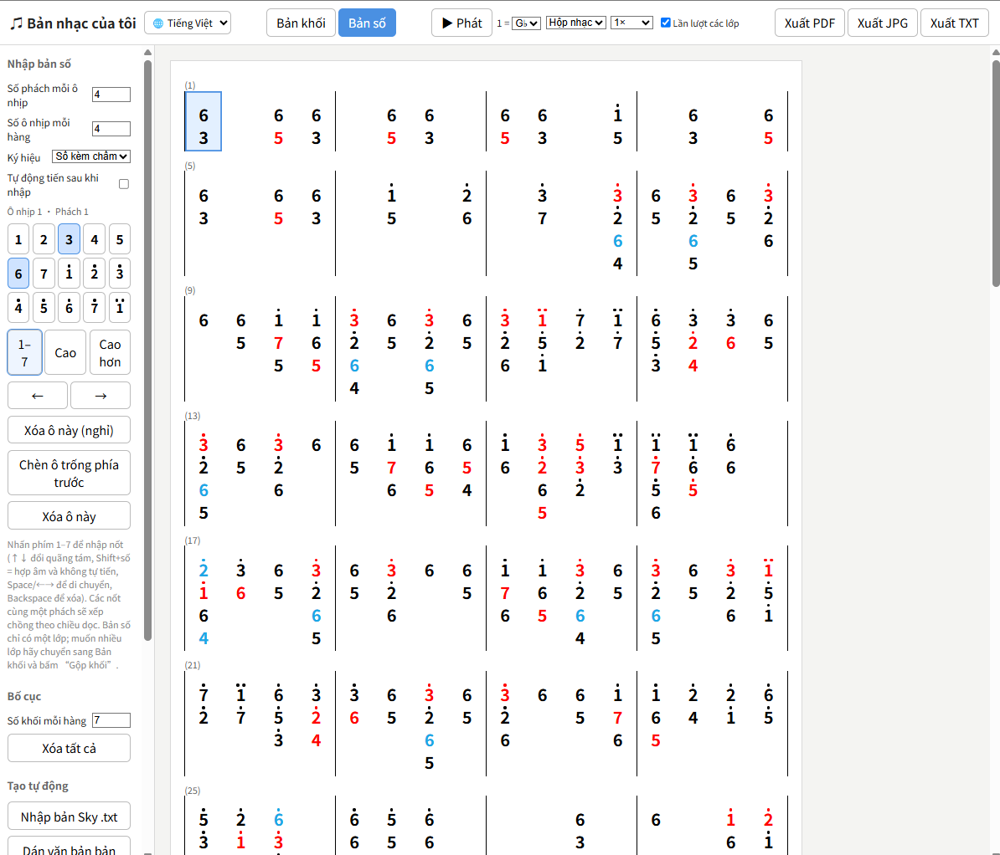
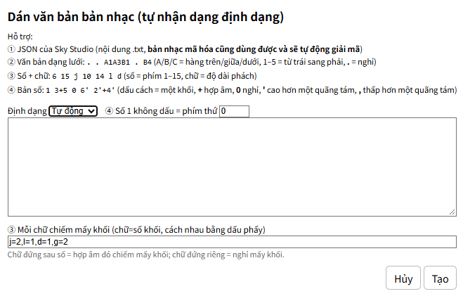

[繁體中文](README.md) ｜ [English](README.en.md) ｜ **Tiếng Việt** ｜ [日本語](README.ja.md)

# ♫ Bản nhạc khối của tôi

Công cụ trực tuyến chuyên chuyển bản nhạc của *Sky: Children of the Light* (Sky: Con của Ánh sáng) sang bản khối và bản số (nhạc số).

Không cần cài đặt phần mềm nào — chỉ cần mở trang web là có thể chỉnh sửa, lưu và xuất bản nhạc.

🌐 Giao diện hỗ trợ **繁體中文 / English / Tiếng Việt / 日本語**. Hãy dùng menu ngôn ngữ ở góc trên bên trái của trang để chuyển đổi (lựa chọn của bạn sẽ được ghi nhớ).



## Sử dụng trực tuyến

🌐 https://anna0212anna0212.github.io/sky/

## Ảnh minh họa




## Tính năng

### Trình soạn bản khối

- Mỗi khối gồm **5 × 3 = 15 phím**
- Hỗ trợ:
  - Màu đen (lớp 1)
  - Màu đỏ (lớp 2)
  - Màu xanh (lớp 3)
- Nhấp hoặc kéo để tô nhanh
- Nhấp lại vào ô cùng màu để xóa
- Có công cụ tẩy

### Phím tắt

| Phím | Chức năng |
|--------|--------|
| 1 | Đen |
| 2 | Đỏ |
| 3 | Xanh |
| 4 hoặc 0 | Tẩy |

## Nhập bản nhạc Sky

### Định dạng được hỗ trợ

- `.txt`
- `.json`

✅ Hỗ trợ tệp bản nhạc xuất từ **Sky Studio** (bản nhạc mã hóa cũng dùng được và sẽ được tự động giải mã).

✅ Các định dạng tương tự cũng dùng được:

```[{"time":0,"key":"1Key8"},{"time":260,"key":"1Key9"},{"time":520,"key":"1Key14"}]```

```A1A4B1 . . . . . . . . . . . . . B3 . . . . . . . . . . . A3B1B4 . . . . . . . . . . . . . . . A3A5B2B5```

```6 15 j 10 14 j 13 15 j 14 j 4 15 j 8 12 j 11 15 j 11 l d 8 l 10 l 6 15 j 10 14 j 13 15 j 14```

```[75,89,-22,98,43,90,126,-21,43,24,14,22,77,56,82,57,68,19,5,93,64,123,71,-31,100,48,137]```

| Định dạng | Cách nhận dạng | Trạng thái |
|--------------------------|--------------------------------------------|-----------------|
| JSON của Sky Studio | Bắt đầu bằng `[` hoặc `{` và chứa `songNotes` | Hỗ trợ đầy đủ |
| Văn bản dạng lưới | Hầu như mọi mục đều là `.` hoặc `A1`–`C5` | Hỗ trợ |
| Số + chữ | Các trường hợp còn lại, ví dụ `6 15 j 10` | Hỗ trợ, nhưng nhịp phách là do mình đoán |
| Mảng số thuần | Mảng JSON chỉ gồm các số | ⭐ Hỗ trợ — cập nhật mới nhất! |

### Cách hoạt động

Sau khi nhập, công cụ sẽ tự động:

- Phân tích thời gian của các nốt
- Ước tính khoảng cách giữa các phách (ms)
- Chuyển thành bản khối
- Tự động tạo nhiều hàng cho bản nhạc

Bạn cũng có thể tự điều chỉnh:

- Số mili giây mỗi khối
- Quy tắc ánh xạ màu
- Cách hiển thị hai lớp

🌟 Khi dùng bản nhạc Sky Studio, hãy lưu ý màu của phím có thể không theo thứ tự phách! Màu được thiết lập theo tệp được nhập vào.

## Dán văn bản bản nhạc (tự nhận dạng định dạng)



### Quy tắc định dạng

Hỗ trợ:
① JSON của Sky Studio (nội dung `.txt`; bản nhạc mã hóa cũng dùng được và sẽ tự động giải mã)
② Văn bản dạng lưới: `. . A1A3B1 . B4` (A/B/C = hàng trên/giữa/dưới, 1–5 = từ trái sang phải, `.` = nghỉ)
③ Số + chữ: `6 15 j 10 14 l d` (số = phím 1–15, chữ = độ dài phách)
④ Bản số: `1 3+5 0 6' 2'+4'` (dấu cách = một khối, `+` hợp âm, `0` nghỉ, `'` cao hơn một quãng tám, `,` thấp hơn một quãng tám)

- Phân tách các khối bằng dấu cách
- Hợp âm dùng dấu `+`
- `0` là dấu nghỉ
- `'` là cao hơn một quãng tám
- `,` là thấp hơn một quãng tám

Ví dụ:

```text
1 3+5 0 6' 2'+4'
```

(Mẹo: bạn có thể đưa ảnh bản nhạc số cho AI và nhờ nó chuyển thành định dạng văn bản này rồi dán vào.)

## Gộp khối
⛔ (Chuyển sang bản số sẽ hủy việc gộp — bản đã gộp không thật sự phù hợp với nhạc số.)

Các khối liên tiếp được gộp theo thứ tự thời gian, thông tin nốt nhạc được thể hiện qua màu của các lớp khác nhau, giúp bản nhạc dễ đọc hơn.

- Lớp 1: đen
- Lớp 2: đỏ
- Lớp 3: xanh
- 🌟 Khối trống nghĩa là nghỉ, sẽ không được gộp và giữ nguyên vị trí ban đầu.
  Nếu muốn gộp tất cả, hãy bấm "Xóa khối trống" trước rồi mới gộp.
- Có chức năng "Xóa khối trống" để sắp xếp gọn bản nhạc theo nhu cầu.
- Sau khi gộp có thể dùng "Hoàn tác" để khôi phục bản nhạc như trước khi gộp.

Khi gộp lại một bản đã gộp, hệ thống sẽ coi các màu hiện có là màu đen và tính lại các lớp. Nếu không muốn các lớp cũ bị tách lại, hãy dùng Hoàn tác.

## Bản số

Cách nhập nốt trực quan hơn bằng chữ số, không cần tô từng ô thủ công.

### Cách nhập nốt

- Dùng các phím `1`–`7` trên bàn phím để nhập nốt.
- Nhấp vào bàn phím số bên phải để nhập nốt.
- Dùng `↑` / `↓` để đổi quãng tám.
- Dùng `←` / `→` hoặc phím cách để di chuyển con trỏ phách.
- Giữ `Shift` để nhập hợp âm trên cùng một phách.

### Cài đặt ký hiệu và bố cục

Có ba kiểu hiển thị ký hiệu:

- Số kèm chấm
- Dấu âm cao
- A–C kèm số

Ngoài ra, bạn có thể tùy chỉnh số phách mỗi ô nhịp và số ô nhịp mỗi hàng để phù hợp với nhịp điệu bài hát và bố cục mong muốn.

## Cập nhật: phát và nghe thử bản nhạc

Có thể phát bản nhạc ngay sau khi chỉnh sửa để nghe thử giai điệu, kiểm tra nốt, cao độ và nhịp điệu, đỡ mất công chỉnh sửa rồi vào game thử nhiều lần.

**Cài đặt phát nhạc**

- **▶ Phát:** phát bản nhạc đang soạn để nghe thử giai điệu và kiểm tra các nốt.
- **Cao độ (1 =):** đặt cao độ ứng với số `1`, giúp bạn điều chỉnh âm vực cho cả bài.
- **Giọng (C, v.v.):** chọn các giọng khác nhau, gồm cả dấu thăng, dấu giáng, để điều chỉnh cao độ của bài.
- **Âm sắc (Piano):** nhiều âm sắc để bạn thử.
- **Tốc độ phát:** chỉnh tốc độ để nghe chậm kiểm tra nốt, luyện nhịp, hoặc nghe nhanh toàn bài.
- **Phát lần lượt các lớp:** chọn có phát lần lượt từng lớp nốt hay không, để nghe và kiểm tra riêng từng lớp.

**Lưu ý**

Tính năng này chủ yếu dùng để nghe thử và hỗ trợ soạn nhạc. Do âm thanh tổng hợp của trình duyệt khác với âm sắc nhạc cụ thật trong *Sky: Children of the Light* 🥲 nên âm thanh có thể không giống hoàn toàn trong game. Vui lòng lấy hiệu quả chơi thực tế trong game làm chuẩn.

# Liên hệ

Nếu bạn gặp bất kỳ vấn đề nào khi dùng công cụ này hoặc có góp ý, hãy liên hệ với mình bất cứ lúc nào:

✉️ Email: yim20000101@gmail.com
